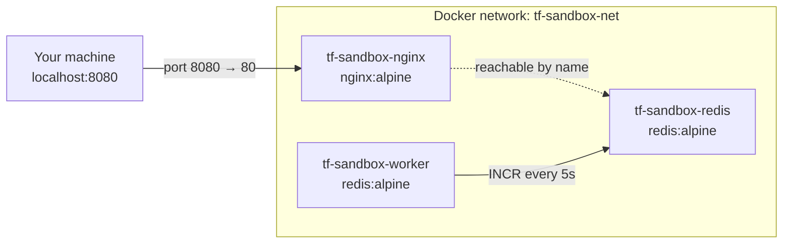

# Terraform Docker Sandbox


A small infrastructure-as-code lab that uses Terraform to stand up a local Docker environment: a public-facing **nginx** web server, a private **Redis** cache, and a **worker** that writes to Redis, all on a shared network.

One reusable module builds all three containers. They differ only in their inputs: whether a port is exposed, which files are uploaded, what command runs, and how health is checked.

## What it builds



| Resource | Image | Reachable from host? | Reachable on network? |
|---|---|---|---|
| `tf-sandbox-nginx` | `nginx:alpine` | Yes, on `localhost:8080` | Yes |
| `tf-sandbox-redis` | `redis:alpine` | No | Yes, as `tf-sandbox-redis:6379` |
| `tf-sandbox-worker` | `redis:alpine` | No | Yes |
| `tf-sandbox-net` | Docker network | n/a | n/a |

## Project structure

```
.
├── main.tf              # Network plus the nginx, redis, and worker modules
├── variables.tf         # host_port (default 8080)
├── outputs.tf           # URL, network name, container names
├── site/
│   └── index.html       # Custom page uploaded into the nginx container
├── versions.tf          # Terraform and Docker provider requirements
├── .github/workflows/
│   └── terraform.yml    # CI: terraform fmt -check and validate on every push
└── modules/
    └── web-container/   # Reusable module: image + container + optional port
        ├── main.tf
        ├── variables.tf
        ├── outputs.tf
        └── versions.tf
```

## How the module works

`modules/web-container` pulls an image, starts a container, and attaches it to a network. The port mapping is optional, controlled by a `dynamic` block:

```hcl
dynamic "ports" {
  for_each = var.internal_port != null ? [1] : []
  content {
    internal = var.internal_port
    external = var.external_port
  }
}
```

- **nginx** passes `internal_port = 80` and `external_port = var.host_port`, so the block is created and the site is published to the host.
- **redis** passes no ports, so the block is skipped entirely. Redis is only reachable by other containers on `tf-sandbox-net`.

Same module, two very different exposure levels, with no duplicated code.

The module also takes an optional `uploads` list for copying files into a container. The root config uses it to replace nginx's default welcome page with `site/index.html`. Edit that file and run `terraform apply` again, and Terraform replaces the container with the new page.

## Requirements

- [Terraform](https://developer.hashicorp.com/terraform/install) 1.5 or newer
- [Docker Desktop](https://www.docker.com/products/docker-desktop/) (or another local Docker daemon) running
- The [kreuzwerker/docker](https://registry.terraform.io/providers/kreuzwerker/docker/latest) provider (~> 3.0), installed automatically by `terraform init`

## Usage

```bash
terraform init
terraform plan
terraform apply
```

Then open the URL from the outputs to see the custom page:

```
url = "http://localhost:8080"
```

Use a different host port if 8080 is taken:

```bash
terraform apply -var="host_port=8081"
```

### Verify the network isolation

nginx answers on the host:

```bash
curl http://localhost:8080
```

Redis does not publish a port, but it answers from inside the network:

```bash
docker run --rm --network tf-sandbox-net redis:alpine redis-cli -h tf-sandbox-redis ping
# PONG
```

### Check container health

nginx and Redis both have Docker health checks. nginx fetches its own page with `wget`, and Redis answers `redis-cli ping`:

```bash
docker ps --format "table {{.Names}}\t{{.Status}}"
# NAMES               STATUS
# tf-sandbox-worker   Up 30 seconds
# tf-sandbox-nginx    Up 31 seconds (healthy)
# tf-sandbox-redis    Up 31 seconds (healthy)
```

### Watch the worker

The worker increments a counter in Redis every 5 seconds and prints the new value:

```bash
docker logs -f tf-sandbox-worker
# 1
# 2
# 3
```

Read the same counter straight from Redis:

```bash
docker exec tf-sandbox-redis redis-cli GET sandbox:heartbeats
```

### Tear it down

```bash
terraform destroy
```

Pulled images are removed on destroy by default. Set `keep_image_locally = true` in a module call to keep them.

## Outputs

| Output | Description |
|---|---|
| `url` | Address of the nginx container on your machine |
| `network_name` | Name of the shared Docker network |
| `web_container_name` | Name of the nginx container |
| `cache_container_name` | Name of the Redis container |
| `worker_container_name` | Name of the worker container |

## Roadmap

- [x] GitHub Actions workflow running `terraform fmt -check` and `terraform validate` on every push
- [x] Serve a custom page from nginx
- [x] Add a small app container that reads and writes to Redis
- [x] Health checks on nginx and Redis
